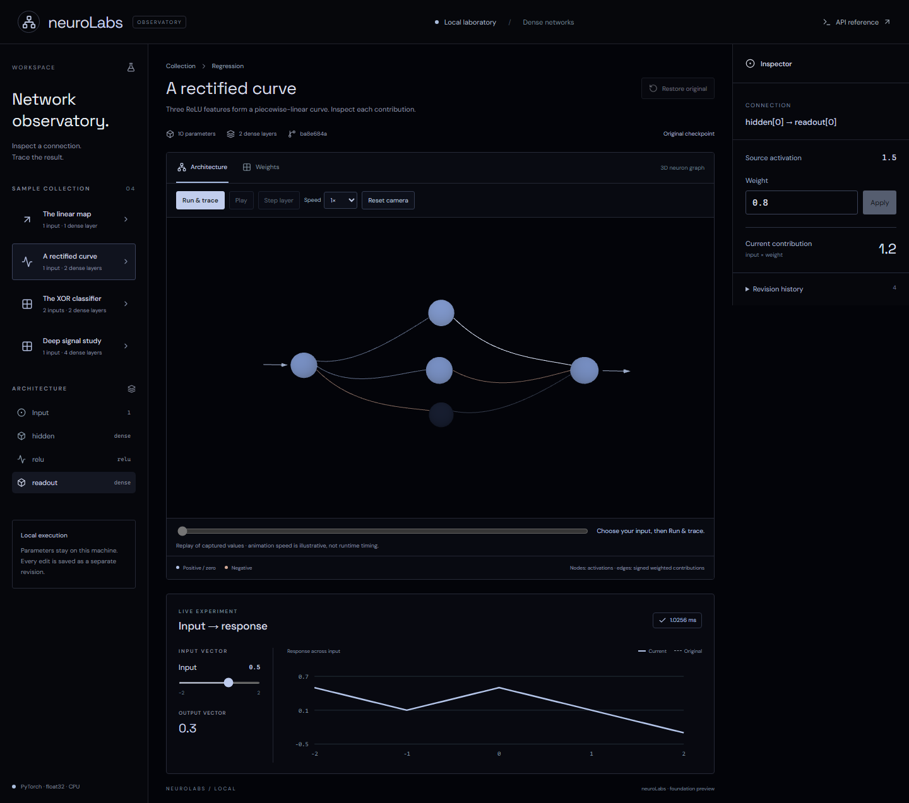

# neuroLabs

A local neural-network laboratory. Inspect actual computations, edit parameters, compare
behavior, and restore immutable revisions. The future research target is blinded inference
and repair of mathematical behavior from corrupted weights.

**Status:** first working foundation preview. Bundled dense models only. See
[implementation status](docs/status.md) and the [architecture/research contract](docs/architecture.md).



## Requirements

- Python 3.12 or 3.13, [uv](https://docs.astral.sh/uv/)
- Node.js 24 LTS and npm
- A desktop browser; no GPU or API key required

## Setup

```sh
uv sync --locked
npm ci
npm run build
uv run uvicorn neurolabs.api:create_app --factory --host 127.0.0.1 --port 8000
```

Open **http://127.0.0.1:8000**. In development, run the backend command above and `npm run dev`
in a second terminal, then open http://127.0.0.1:5173. Vite proxies API requests locally.

On Windows, `scripts/start.ps1` starts the built application with the project's virtual
environment. Build first. It does not install dependencies or open a browser automatically.

The default runtime data location is `%LOCALAPPDATA%/neuroLabs` on Windows and
`~/.local/share/neuroLabs` elsewhere. Keep live data outside cloud-synced folders.
Override with `NEUROLABS_DATA_DIR` if needed. Original sample weights are never overwritten.
Existing NeuroLens experiment directories, database files, and the legacy data-directory
environment variable remain supported, so the rename preserves saved revisions.

## Try the first experiment

1. Select **The linear map**, whose original behavior is `f(x) = 0.5x`.
2. Change input `x₀` and inspect the output and response plot.
3. Click the connection, change its weight to `1` in the inspector, and apply the edit.
4. Compare the current curve with the dashed original curve.
5. Restore the original checkpoint, or select a previous revision in history.
6. Reload the browser: the current revision persists.

The other fixtures demonstrate a piecewise-linear ReLU curve and XOR classification.
They are analytic examples, not trained-model performance claims. XOR outputs are logits.

## Explore the 3D neuron graph

Choose an input, then click **Run & trace**. Drag to rotate, scroll to zoom, and right-drag
to pan. Use Pause, Step layer, or the timeline to inspect propagation. Click a neuron
to select its incoming weights and mathematical computation in the inspector.

The graph displays actual captured activations. ReLU outputs of zero are dimmed;
positive/negative contributions have distinct colors. A dense network evaluates every
connection, so the trace shows distributed contributions rather than a single chosen path.
Playback timing is illustrative. Changing input or weights clears the previous trace.

Click a string to open that connection's weight and current incoming
activation × weight in the inspector. Click a neuron to inspect its activation function,
weighted sum, output and bias. Neurons with biases select their bias editor automatically.
Enter a value and press Apply or Enter: outputs and the response plot recompute,
while the original remains available to restore.
The inspector keeps one relevant editor per selection. Incoming neuron contributions
and revision history expand on demand. Full tensors and matrix selection are available
in the Weights tab; input neurons show only their input value. Displayed edit values
use short decimals that round-trip to the stored float32 parameter.
Input nodes have no bias; models without a bias parameter do not gain one implicitly.

The graph contains nodes and thin, flexible strings, without any text or numbers.
String interiors gently drift while their endpoints stay attached; reduced-motion
preferences freeze the movement. This visual deformation does not alter computation.
The dark background and diffuse neurons have no stars or glossy highlights. Arrows
identify inputs/outputs. All values and explanations live in the inspector. Keyboard
selection remains available, and playback particles follow the same curved strings.

**Deep signal study** adds a five-layer example (`1 → 3 → 3 → 2 → 1`) with twenty
weighted connections and nine biases. It is a hand-constructed Tanh network.

The execution contract allows up to 16 dense layers, width 256 and one million parameters,
but the current 3D view is designed for small examples. Large models require
grouped layers, focused connections, bounded tensor slices and matrix views before import
can be enabled; the execution limit is not a browser-rendering performance guarantee.

## Verify

```sh
uv run pytest -q
uv run ruff check backend
uv run ruff format --check backend
npm run build
```

Browser regression checks (after `npx playwright install chromium`):

```sh
npm run test:e2e
```

The browser tests start their own server on port 8001 with an isolated data directory.
CI runs backend and browser checks on Windows and Linux.

Numerical tests use an independent ONNX Runtime reference, non-square matrices,
known functions, and all supported activations. Storage tests cover immutability,
concurrent edit conflicts, idempotency, atomic rejection, branching, restart and corruption.

## Programmatic access

Open http://127.0.0.1:8000/docs for the current API. Obtain `/api/v1/session` and provide its
`token` as `X-NeuroLabs-Session` for POST requests. This credential is local and changes
on server restart. A run explicitly names a revision, input matrix and requested captures.
Returned results include effective inputs, their hash, revision ID and runtime provenance.

The API is the future agent interface. The agent implementation and hidden evaluator are
not present yet. No model code or unsafe checkpoint deserialization is accepted.
