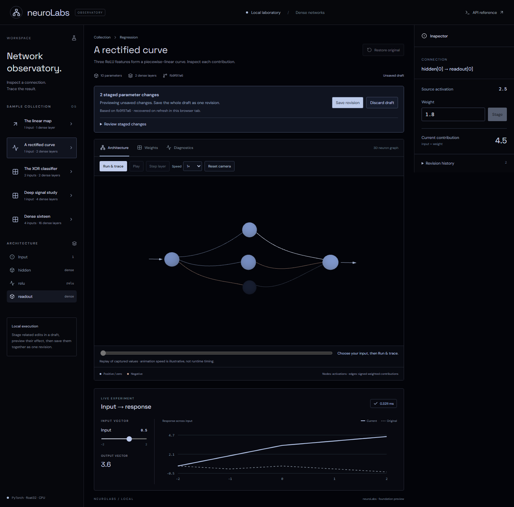
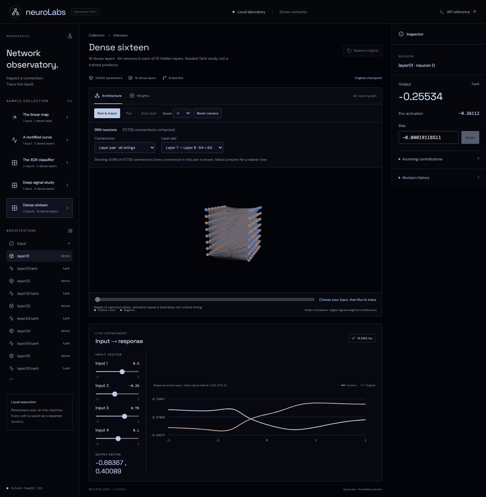

# neuroLabs

A local neural-network laboratory. Inspect actual computations, edit parameters, compare
behavior, and restore immutable revisions. The future research target is blinded inference
and repair of mathematical behavior from corrupted weights.

**Status:** first working foundation preview. The browser uses bundled dense models;
the Python audit bridge accepts supported in-memory MLPs. See
[implementation status](docs/status.md) and the [architecture/research contract](docs/architecture.md).


**New: batch diagnostics.** Audit inactive ReLU/saturated activations across input batches,
compare revisions on identical inputs, inspect affected neurons/cases in 3D, and export
the evidence. An in-memory Python bridge also accepts supported float32 Sequential MLPs
from your own code. See [the two engineering workflows](docs/diagnostics.md) for scope and usage.

## Requirements

- Python 3.12 or 3.13, [uv](https://docs.astral.sh/uv/)
- Node.js 24 LTS and npm
- A desktop browser; no GPU or API key required

## Setup

```sh
uv sync --locked
npm ci
npm run build
uv run uvicorn neurolabs.api:create_app --factory --host 127.0.0.1 --port 8000
```

Open **http://127.0.0.1:8000**. In development, run the backend command above and `npm run dev`
in a second terminal, then open http://127.0.0.1:5173. Vite proxies API requests locally.

On Windows, `scripts/start.ps1` starts the built application with the project's virtual
environment. Build first. It does not install dependencies or open a browser automatically.

The default runtime data location is `%LOCALAPPDATA%/neuroLabs` on Windows and
`~/.local/share/neuroLabs` elsewhere. Keep live data outside cloud-synced folders.
Override with `NEUROLABS_DATA_DIR` if needed. Original sample weights are never overwritten.
Existing NeuroLens experiment directories, database files, and the legacy data-directory
environment variable remain supported, so the rename preserves saved revisions.

## Try the first experiment

1. Select **The linear map**, whose original behavior is `f(x) = 0.5x`.
2. Change input `x₀` and inspect the output and response plot.
3. Click the connection, change its weight to `1` in the inspector, and press **Stage**.
4. Compare the current curve with the dashed original curve.
5. Stage other related edits, then click **Save revision** once to commit the group.
6. Restore the original checkpoint, or select a previous revision in history.
7. Reload the browser: saved revisions persist, and unsaved drafts recover in the same tab.

The other fixtures demonstrate a piecewise-linear ReLU curve and XOR classification.
They are analytic examples, not trained-model performance claims. XOR outputs are logits.

## Explore the 3D neuron graph

Choose an input, then click **Run & trace**. Drag to rotate, scroll to zoom, and right-drag
to pan. Use Pause, Step layer, or the timeline to inspect propagation. Click a neuron
to select its incoming weights and mathematical computation in the inspector.

The graph displays actual captured activations. ReLU outputs of zero are dimmed;
positive/negative contributions have distinct colors. A dense network evaluates every
connection, so the trace shows distributed contributions rather than a single chosen path.
Playback timing is illustrative. Changing input or weights clears the previous trace.

Click a string to open that connection's weight and current incoming
activation × weight in the inspector. Click a neuron to inspect its activation function,
weighted sum, output and bias. Neurons with biases select their bias editor automatically.
Enter a value and press **Stage** or Enter: outputs and the response plot preview the
unsaved draft. Edit several weights/biases, then **Save revision** to commit them atomically
as one revision. **Discard draft** restores the saved parameters. Re-editing one coordinate
updates the same pending change; returning it to its saved value unstages it. Up to 4,096
changed coordinates can be grouped. Review/undo individual changes in the draft bar.
Drafts are isolated per model and recover after refreshing the same browser tab; they are
not saved model revisions until explicitly committed. A changed saved head blocks a stale
draft rather than silently rebasing it. Saved revision history/restoration is available
after saving or discarding the draft. The original model remains intact.


The inspector keeps one relevant editor per selection. Incoming neuron contributions
and revision history expand on demand. Full tensors and matrix selection are available
in the Weights tab; input neurons show only their input value. Displayed edit values
use short decimals that round-trip to the stored float32 parameter.
Input nodes have no bias; models without a bias parameter do not gain one implicitly.

The graph contains nodes and thin, flexible strings, without any text or numbers.
String interiors gently drift while their endpoints stay attached; reduced-motion
preferences freeze the movement. This visual deformation does not alter computation.
The dark background and diffuse neurons have no stars or glossy highlights. Arrows
identify inputs/outputs. All values and explanations live in the inspector. Keyboard
selection remains available, and playback particles follow the same curved strings.

**Deep signal study** adds a five-layer example (`1 → 3 → 3 → 2 → 1`) with twenty
weighted connections and nine biases. It is a hand-constructed Tanh network.

**Dense sixteen** reaches the execution contract's depth limit: 4 inputs, fifteen
64-neuron Tanh hidden layers, and a 2-neuron linear output. That is **16 dense layers**
(17 neuron layers including input), **966 neurons**, **57,728 weights**, and **58,690
parameters** including biases. Its seeded random parameters are reproducible; it has no
trained task or accuracy claim. Every forward pass and response slice uses all weights.

For dense scenes, the **Connections** control offers:

- **Overview:** every neuron, with up to 96 evenly distributed strings per transition.
  The counter states exactly how many connections are shown; this is a view filter.
- **All connections:** every neuron and every string across the entire network—57,728
  connections in Dense sixteen. Selection and forward-pass replay remain available.
- **Layer pair:** all connections between two adjacent layers, including all 4,096
  strings between 64-neuron layers. The camera frames that pair.
- **Selected neuron:** every incoming and outgoing string for the chosen neuron.
  Pick in 3D or use the layer/index selectors. Click a string to inspect/edit its weight;
  click a neuron to inspect/edit its bias. Keyboard string targets are available in this
  view; the matrix and incoming-contribution list also reach individual connections.



Dense scenes use instanced neurons and batched curves, with animation capped at 30 fps
(15 fps in the full-network view). The graph remains free of text and numbers.
The contract still allows width 256
and one million parameters, but this bundled 64-wide study is the current large example.
General import, bounded tensor APIs, and broader hardware/memory profiling remain future work.

## Verify

```sh
uv run pytest -q
uv run ruff check backend
uv run ruff format --check backend
npm run build
```

Browser regression checks (after `npx playwright install chromium`):

```sh
npm run test:e2e
```

The browser tests start their own server on port 8001 with an isolated data directory.
CI runs backend and browser checks on Windows and Linux.

Numerical tests use an independent ONNX Runtime reference, non-square matrices,
known functions, and all supported activations. Storage tests cover immutability,
concurrent edit conflicts, idempotency, atomic rejection, branching, restart and corruption.

## Programmatic access

Open http://127.0.0.1:8000/docs for the current API. Obtain `/api/v1/session` and provide its
`token` as `X-NeuroLabs-Session` for POST requests. This credential is local and changes
on server restart. A run explicitly names a revision, input matrix and requested captures.
Returned results include effective inputs, their hash, revision ID and runtime provenance.

The API is the future agent interface. The agent implementation and hidden evaluator are
not present yet. No model code or unsafe checkpoint deserialization is accepted.
