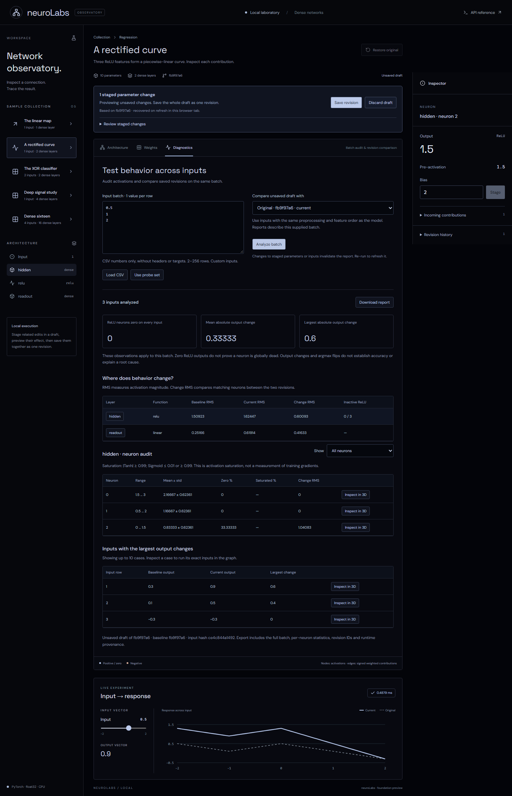

# Two engineering workflows

The visual graph is an inspection surface. The useful product is a repeatable experiment
that helps an engineer find a concrete case or neuron worth investigating.

## 1. Audit activations across validation inputs

An engineer suspects a checkpoint, initialization or preprocessing change has left some
ReLU neurons inactive. Run a batch of representative inputs, review each neuron's zero
fraction and range, and jump from the report to that neuron in 3D. Inspect a concrete
input and its incoming contributions before deciding what to change.

The audit reports exact zero fractions, population mean/std, min/max, activation RMS,
and Tanh/Sigmoid saturation fractions. A ReLU flagged as inactive produced exactly zero
for every supplied row. It may activate outside that batch and may not be needed for
the task. This is not a diagnosis of an initialization or optimizer problem.

Saturation thresholds are explicit: absolute Tanh output at least 0.99, or Sigmoid
output at most 0.01 or at least 0.99. The UI can filter neurons saturated on at least
90% of inputs. These are inspectable activation statistics, not measured gradients.

This follows the useful numerical-inspection direction of
[TensorBoard Debugger V2](https://www.tensorflow.org/tensorboard/debugger_v2), while
connecting batch observations to individual graph selections.

## 2. Check the behavioral impact of a parameter change

An engineer prunes weights, edits a bias, or tests a repair to a corrupted checkpoint.
Compare the candidate and a reference on exactly the same inputs. Review mean/largest
absolute output change, layer and neuron change RMS, and the inputs with the largest
differences. Open one of those inputs in the graph and inspect the actual computation.

For declared multiclass classification with at least two outputs, the report also counts
changed argmax predictions. It does not call logits calibrated confidence or infer
accuracy without labels. Zero change on a finite batch is not proof of functional
equivalence elsewhere. Matched neurons require identical architectures.

[Captum's perturbation methods](https://captum.ai/api/feature_ablation.html) provide a
related reference for measuring output differences under controlled changes. This
implementation compares entire saved parameter revisions; it does not claim to implement
Captum attribution, isolate a causal neuron, or explain why a prediction is correct.

## Browser workflow

1. Select a bundled model and open **Diagnostics**.
2. Paste inputs or load a CSV: numeric values only, no header or target columns, one
   input vector per line. Supply 2–256 rows with the model's exact input width.
   CSV files are limited to 256 KiB. Values must remain finite in float32.
3. Choose an original or saved reference revision and click **Analyze batch**.
4. Select a layer and filter its neurons. **Inspect in 3D** selects the corresponding
   neuron; dense networks open its full incoming/outgoing connections.
5. Inspect a changed input, edit a parameter, and return to Diagnostics. The batch is
   retained; the outdated report is cleared. Re-run the audit to measure the edit.
6. Download the JSON report to retain exact inputs/outputs, full per-neuron statistics,
   thresholds, input/spec/parameter SHA-256 fingerprints, revision IDs and runtime provenance.

Generated probe sets are for exercising the UI and are explicitly labeled. They are not
training data or evidence about a real model's deployment distribution. Reports are not
saved in the experiment database; use Download report to retain them. Changing inputs,
reference revision, model or current weights invalidates results, including pending requests.

An exact demonstration: select the original rectified curve and audit rows `0.5`, `1`,
and `2`. Hidden neuron 2 is zero throughout that positive-input batch. Inspect it and
change its bias from 0 to 2, then re-run against Original: the largest output change is
0.6, and the neuron is no longer inactive on every supplied input. Restoring Original
reverses the experiment. Negative input batches show why the original neuron was not
globally dead.



## Use your own MLP from Python

Browser model import is still unavailable. Engineers can run the same audit on their own
already-created `torch.nn.Sequential` model through the Python entry point:

```python
import json
from pathlib import Path
from neurolabs.diagnostics import analyze_sequential

# candidate_model, reference_model and validation_inputs come from your own code.
report = analyze_sequential(
    candidate_model,
    validation_inputs,  # list of vectors or a tensor with shape [batch, features]
    baseline_model=reference_model,
    revision_id="candidate-checkpoint",
    baseline_revision_id="reference-checkpoint",
    task="classification",  # or "regression" / "unknown"
)
Path("audit.json").write_text(json.dumps(report, indent=2, allow_nan=False))
```

Omit `baseline_model` to audit one checkpoint against itself. This bridge supports exact
built-in Sequential modules: Linear, ReLU, Tanh, Sigmoid, Identity, and final Softmax over
the feature dimension. It must begin with Linear. Custom subclasses, nested containers,
Dropout, BatchNorm, shared modules, forward overrides and forward hooks are rejected.
Materialize any pruning masks in the weights before taking these snapshots.
It uses the same contract limits:
16 dense layers, width 256, 1,000,000 parameters and 2–256 input rows. Parameters must be
float32; GPU parameters are copied to CPU snapshots. No forward method, serialized model
file or unpickling is invoked by the bridge. The caller's model, training mode, parameters,
gradients and RNG state are not changed. Reports execute with the application-owned CPU
operators and include exact parameter fingerprints.

The Python report does not register a model in the browser. Importing an arbitrary
report to render its graph is also not implemented.

## Deliberately deferred

See [the later-work roadmap](roadmap.md) for candidate interventions, architecture-aware
revisions and the proposed instrumented-training/control workstream.

- Training-gradient diagnostics: require a declared loss, labels/targets or an explicitly
  selected scalar output, and actual autograd capture. Small activations are not evidence
  of vanishing gradients.
- Misclassification diagnosis, accuracy and calibration: need labeled evaluation data.
- CNN feature maps and semantic feature interpretations: need CNN operators and appropriate
  experiments. The random dense study has not learned image features.
- General checkpoint import: remains subject to operator compatibility, bounded resource
  execution and storage/import feasibility gates.

The first release focuses on these two measured workflows rather than adding speculative
interpretability panels. This does not implement the later blinded LLM recovery benchmark.
